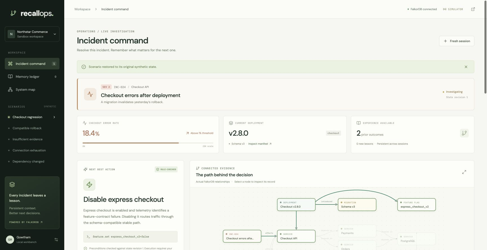
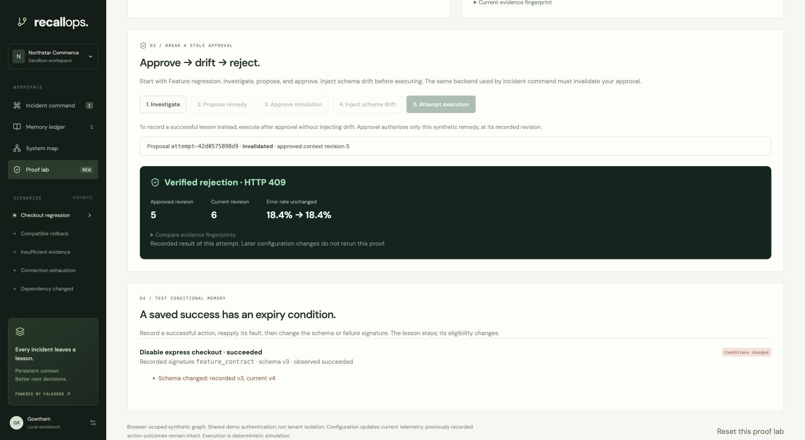
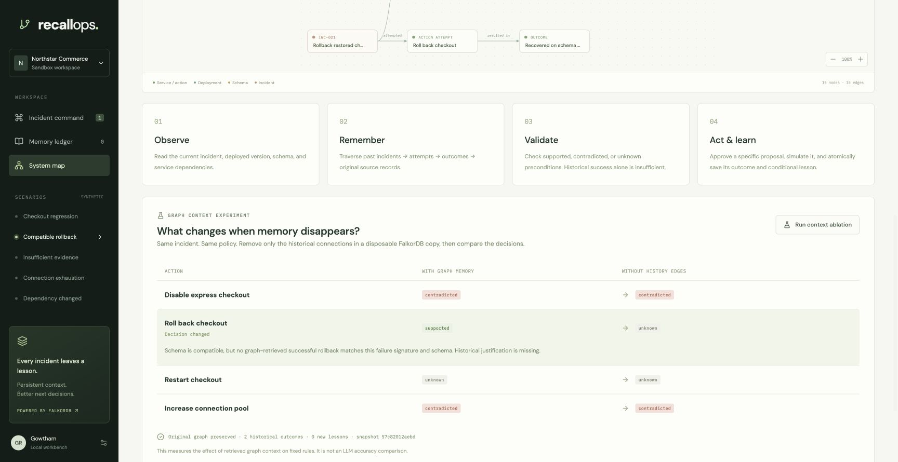
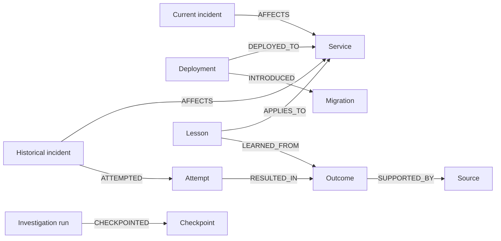

# RecallOps

**An incident agent that remembers failed fixes—and knows when yesterday’s successful fix no longer applies.**

RecallOps is an incident command center for Graph Hacks 2026. FalkorDB holds service dependencies, current deployment conditions, historical attempts, observed outcomes, and conditional lessons. Recommendations are checked against current state before the user can approve a simulated action.



**Tracks:** Agent Memory and Coordination; Agents That Act on Connected Data.

[Watch the demo on YouTube](https://youtu.be/UNLjAmICQVE) · [Video and captions download](https://github.com/gowtham66867/recallops-graphhacks/releases/tag/v1.0.0) · [Protected live app](https://34.46.171.202.sslip.io)

The video uses actual app captures with synthetic narration. It demonstrates
**deterministic investigation**, not a validated live-model run. Captions and the
[full transcript](docs/DEMO.md) are included. The hosted app requires the demo
login; local setup below runs the complete workflow without a model key.

[Architecture](docs/ARCHITECTURE.md) · [Central Cypher queries](docs/GRAPH_QUERIES.cypher) · [Measured evaluation](docs/architecture-evaluation.json) · [Verification](docs/VERIFICATION.md) · [Build story](docs/BLOG.md)

## Preserve responder context and review the handoff

[Responder context](https://34.46.171.202.sslip.io/?view=handoff) adds source-linked
operator observations, prior attempts, corrections, explicit gaps, and reviewed
internal/anonymized JSON exports. Reports stay unverified and cannot override
execution policy. Approvals bind an audience to the current factual fingerprint.
Voice preferences survive refresh; optional Gemini audio requires a separate key
and consent. Live audio remains unverified. Procedural prompts support English,
Hindi, Kannada and Hinglish; operational summaries remain English.

[35-item adaptation and limits](docs/FEEDBACK_IMPLEMENTATION.md) · 87 Python tests
and 8 frontend tests pass (95 total). The original core video predates this upgrade.

## Challenge the system yourself

Open **[Proof lab](https://34.46.171.202.sslip.io/?view=lab)** after signing in:

1. **Build an incident:** choose a fault preset or change the signature, schema,
   feature flag, pool saturation, and error rate. Inspect the policy immediately.
2. **Break an approval:** Investigate → Propose → Approve → Inject schema drift →
   Attempt execution. The actual executor returns HTTP 409, invalidates the
   proposal, and leaves the incident unchanged.
3. **Expire a memory:** execute a valid remedy without drift to save a lesson.
   Reapply its fault to see it become eligible. Change schema v3 to v4 to retain
   the observation while rejecting its reuse.

Each browser gets a separate synthetic graph. This preserves the five main
scenarios but is **not authenticated tenant isolation**. These experiments use
the same verified workflow and executor as Incident command. The suite now has
**95 passing tests** across Python and frontend checks, including real FalkorDB API races and isolation checks.
See the [two-minute judge walkthrough](docs/PROOF_LAB.md).



## The experiment that makes the graph matter

Open **System map → Run context ablation**. RecallOps copies the current factual
snapshot into a disposable, real FalkorDB graph, removes only the historical
`AFFECTS` and lesson `APPLIES_TO` edges, then runs the same policy again.
The original incident graph is preserved and the disposable copy is deleted.

| Scenario / action | With connected history | Without history edges |
| --- | --- | --- |
| Checkout regression / restart | Contradicted by an observed failure | Unknown |
| Compatible rollback / rollback | Supported by matching recovery | Unknown |

These are measured effects of graph context on deterministic rules, not an LLM
accuracy benchmark. Current schema incompatibility remains contradicted even
without history; removing context does not make an unsafe action safe.



## Graph data model



Nodes share the `Entity` label and carry `id`, `kind`, `title`, and JSON `data`.
Relationships are native graph edges. Each scenario has its own named graph;
this is scenario separation, not per-user isolation. See the exact queries in
[GRAPH_QUERIES.cypher](docs/GRAPH_QUERIES.cypher).

## Run

Prerequisites: Docker Desktop running, Node.js 22.12+ (tested on Node 24), npm, and [uv](https://docs.astral.sh/uv/).

```sh
./scripts/start.sh
```

Open **http://127.0.0.1:8000**. The script installs Python 3.12 dependencies from the lockfile, builds the frontend, starts FalkorDB with persistent storage, and serves the application. It binds the API and database ports to loopback. Stop the API with Ctrl-C; stop the database with `docker compose stop`. Keep the named volume to retain lessons.

For separate development servers:

```sh
uv venv --python 3.12 .venv
uv pip sync requirements.lock.txt
docker compose up -d --wait
npm ci --prefix frontend
npm run dev --prefix frontend
# In another terminal:
.venv/bin/python -m uvicorn backend.main:app --reload --host 127.0.0.1 --port 8000
```

Vite serves http://127.0.0.1:5173 and proxies `/api` to FastAPI. API reference: http://127.0.0.1:8000/docs . In production-build local mode, FastAPI serves the compiled React application itself.

## Try the defining workflow

1. Open **Checkout regression**. Investigation runs deterministic tools against real FalkorDB data.
2. Select **Restart checkout**: the matching historical attempt failed.
3. Select **Roll back checkout**: historical success required schema v2; the current schema is v3. Click a source chip to inspect the original record.
4. Select **Review simulated action**, inspect preconditions, then **Approve & run simulation**.
5. Error rate changes from 18.4% to 0.2% according to the simulator’s transition rules. The attempt, outcome, source, and conditional lesson are committed atomically in one graph query.
6. Open **Fresh session**. The memory ledger retrieves the persisted lesson.
7. Select **Replay with memory**. This explicitly reintroduces the synthetic fault without erasing experience. The recommendation now cites the earlier observed outcome after rechecking signature and schema.
8. Try **Compatible rollback**, **Insufficient evidence**, **Connection exhaustion**, and **Dependency changed**. Each scenario uses its own named FalkorDB graph. Reset removes only the selected scenario’s new data.

## Optional live agent

Copy `.env.example` to `.env` and configure `OPENAI_API_KEY` locally. Set `OPENAI_MODEL` to a model your API account supports (default `gpt-4.1-mini`). Restart the backend, enable **Live tool-calling agent**, and enter an investigation question.

Only this repository’s `.env` is loaded. Parent project credentials are not automatically discovered. Keep secrets out of source control. This application does not require a key for deterministic investigation, graph inspection, simulation, or persistent recall.

The live path uses the OpenAI Responses API with six bounded read-only evidence/forecast tools and a typed `submit_assessment` tool. The investigator selects a supported action or abstains, citing original sources and explicit uncertainties. It permits up to 8 requests and 12 function calls, with a 25-second request timeout and a 90-second budget checked between requests (the last request may extend that by its timeout). A separate structured model critic adds at most one request. Neither model can approve or execute actions. Invalid citations, failed deterministic checks or a rejected critique block the handoff.

The fixed typed plan runs three deterministic specialists concurrently. Their evidence feeds synthesis; five phase checkpoints persist in FalkorDB. The Saved investigations panel discovers interrupted runs and offers resume; the same recovery operations are exposed through the API. Proposals require a completed verified `run_id`; evidence hashes bind investigation, approval and execution. See [architecture](docs/ARCHITECTURE.md) and [query reference](docs/GRAPH_QUERIES.cypher).

The provider path has mocked contract tests. A real request was attempted and returned HTTP 429 `credit_balance_exhausted`; no successful live-model investigation or model-quality result is claimed. The hosted demo runs in deterministic mode.

## Verification

For the container deployment package, persistent storage, and cloud account access
requirements, see [deployment instructions](docs/DEPLOYMENT.md).

```sh
docker compose up -d --wait
.venv/bin/python -m pytest -q
.venv/bin/python -m scripts.evaluate
.venv/bin/python -m scripts.evaluate_architecture
npm run build --prefix frontend
```

Tests use actual FalkorDB under disposable, unique graph names; they do not reset the app’s graph. The evaluation generates [docs/evaluation.json](docs/evaluation.json) from five predefined scenarios and tests evidence resolution, execution, persistence, idempotence, and conditional reuse. See [docs/VERIFICATION.md](docs/VERIFICATION.md) for observed checks and limitations.

## Why FalkorDB matters

The agent reads `Incident → Service ← Historical incident → Attempt → Outcome → Source` and `Deployment → Migration` paths. Conditional lessons are linked to service and outcome records. Named graphs separate scenarios. Graph unavailability is a visible 503; no hidden in-memory dataset supplies answers. The implementation demonstrates the value of connected persistent context; it does not claim that relational databases cannot express these joins.

## Boundaries

- Every company, service, incident, and metric is synthetic. The simulator is deterministic and is not a real observability system or production remediation integration.
- One shared synthetic workspace. The hosted demo uses password-protected HTTPS; it has no tenant isolation, RBAC, or per-user authorization.
- User approval is bound to a specific proposal revision. Preconditions are rechecked at execution; changed state invalidates the proposal.
- Redis locks serialize local workbench mutations and retries. Simulator effects and their outcome records are written in one atomic graph query; this is not a transaction system for external effects.
- Unknown evidence does not establish safety. A prior success is reused only when current preconditions pass and the recorded signature and schema match.
- The graph visualization shows a bounded operational/historical subgraph; full original source text is available through source chips. The error meter is calculated from actual simulator state and uses a labeled 0–25% display scale.
- Typography uses Google Fonts when online, with system fallbacks offline.
- A password-protected Google Cloud demo is deployed; see [deployment instructions](docs/DEPLOYMENT.md). The public source and captioned demo were submitted to Graph Hacks on October 18, 2026; see [submission record](docs/SUBMISSION.md).

## Project map

- `backend/store.py`: FalkorDB persistence and traversals
- `backend/fixtures.py`: synthetic scenario inputs
- `backend/engine.py`: applicability, approvals, simulator, atomic outcome writes
- `backend/agent.py`: bounded ReAct investigator and typed assessment
- `backend/workflow.py`: specialist coordination, checkpoints, review and verified handoff
- `backend/evidence.py`: factual context digests, counterfactuals and evidence verification
- `backend/main.py`: API and compiled frontend serving
- `frontend/src/`: React application, interactive SVG graph, responsive styling
- `tests/`: real-database integration and provider-contract tests
- `docs/`: architecture, measured evaluation, demo script, submission and blog drafts

Official event: https://www.wemakedevs.org/hackathons/falkordb . Requirements checked October 18, 2026. Implementation is new work in this workspace. AI coding assistance was used; the submitter should review and understand the code and tradeoffs before submitting.
