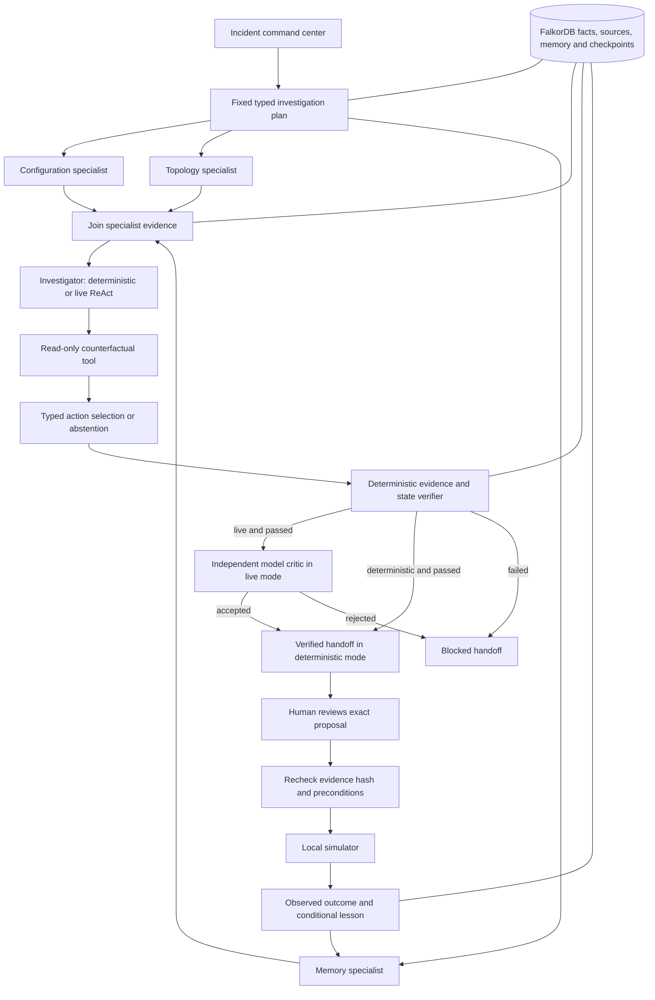

# Architecture

## Runtime and authority

RecallOps uses one FastAPI process and FalkorDB. It has explicit stage contracts and typed model assessments. The fixed investigation plan runs three deterministic read-only specialists concurrently, then joins their findings before investigation and review. These workers are not presented as independent LLM agents.



The live researcher must use six bounded read-only tools, including counterfactual comparison, then call `submit_assessment` with a selected supported action or null, an explanation, retrieved original source IDs and explicit uncertainties. A rejected tool submission may be corrected within the same fixed request budget. Merely returning prose cannot complete a live investigation.

The model's chosen action is subject to deterministic checks and a separate structured model critic. Either can block the handoff. The critic sees the draft, rule results and original sources, and has no write or execution tools. Model agreement is advisory, not evidence of correctness. Deterministic mode uses the same persistence, evidence, forecast and authority boundaries, with no model call.

## Durable investigation lifecycle

`plan → collect → reason → review → complete` checkpoints are written to FalkorDB as an `InvestigationRun` plus linked `Checkpoint` records. Stage outputs, factual inputs, tool summaries, verification and final handoff are persisted. A per-run Redis lease prevents two workers from resuming the same run concurrently.

- `GET /api/{scenario}/runs` discovers recent runs, including interrupted runs whose original request failed. The Saved investigations panel exposes recovery controls.
- `GET /api/{scenario}/runs/{id}` inspects a recorded run.
- `POST /api/{scenario}/runs/{id}/resume` resumes after interruption when the factual context is unchanged.
- Completed stages are reused. Individual model/tool calls inside a stage are not checkpointed; interrupted read-only stages may repeat.
- The endpoint is synchronous. There is no external queue or automatic restart daemon.
- A blocked review requires a new investigation after issues are addressed; it is not silently promoted to success.

A SHA-256 digest covers a canonical bounded factual graph: operational and historical entities, source content, relevant relationships and conditional lessons. Session metadata, checkpoint writes, and unfinished proposals are excluded so the investigation does not invalidate itself. Evidence changes during collection or before review block completion. A completed run cannot justify an action against different evidence.

Public proposals require `run_id` and must match that verified run's recommendation. The proposal saves the context hash; approval and execution check it again. This catches changed source text, schema, dependency relationships or memory even if the incident revision was not incremented.

## Counterfactuals and epistemic status

Candidate forecasts run pure simulator transition functions without changing incident state or writing lessons. Unsupported actions are blocked or unknown, rather than executed experimentally. Predicted error rates are explicitly labelled predictions. Only an approved actual simulator transition can create an observed outcome.

The evidence verifier checks source record existence, original-source linkage, fresh applicability, and context consistency. It does not prove semantic entailment of arbitrary natural-language claims. Live citation admission and the independent model critic add checks but do not establish general factual accuracy.

## Graph representation

Nodes use a common `Entity` label with unique application `id`, `kind`, `title`, and JSON `data`. Entity kinds include Service, Incident, Deployment, Migration, FeatureFlag, ActionDefinition, ActionAttempt, Outcome, Source, Lesson, and Session. This compact prototype stores evolving scalar fields in JSON; relationships remain native graph edges. A production schema could promote frequently filtered fields into indexed properties and enforce stronger identity constraints.

One graph per scenario: `recallops_checkout`, `recallops_rollback_valid`, `recallops_unknown`, `recallops_pool`, `recallops_dependency`. This is scenario separation, not authenticated user isolation.

Operational relationships:

```cypher
MATCH p=(service:Entity {id: $id})-[:DEPENDS_ON*1..4]->(dependency:Entity)
RETURN dependency.data, length(p)
LIMIT 30
```

Historical evidence:

```cypher
MATCH (current:Entity {id: $id})-[:AFFECTS]->(service:Entity)
  <-[:AFFECTS]-(incident:Entity)-[:ATTEMPTED]->(attempt:Entity)
  -[:RESULTED_IN]->(outcome:Entity)-[:SUPPORTED_BY]->(source:Entity)
RETURN incident.data, attempt.data, outcome.data, source.data
LIMIT 30
```

Current conditions:

```cypher
MATCH (incident:Entity {id: $id})-[:AFFECTS]->(service:Entity)
  <-[:DEPLOYED_TO]-(deployment:Entity)-[:INTRODUCED]->(migration:Entity)
WHERE migration.kind = $kind
RETURN incident.data, deployment.data, migration.data
LIMIT 1
```

Learned experience:

```cypher
MATCH (lesson:Entity)-[:APPLIES_TO]->(:Entity {id: $id})
WHERE lesson.kind = $kind
RETURN lesson.data
LIMIT 20
```

A lesson `LEARNED_FROM` an Outcome is also connected to checkout through `APPLIES_TO`. Outcomes `SUPPORTED_BY` original Source records preserve the observed context. Lessons are never automatically deleted because they become inapplicable.

## Applicability

Each action returns supported, contradicted, or unknown, with evidence IDs and explicit preconditions.

- Restart: reject when the same signature has a recorded failed attempt; otherwise remain unknown without evidence of a transient worker fault.
- Rollback: require verified current schema, matching previous-version schema, and an observed release regression.
- Disable express checkout: require enabled flag, observed feature-contract signature, and a verified stable-path-supported schema.
- Scale pool: require observed pool saturation and a connection-exhaustion signature.

Rollback support requires graph-retrieved successful history matching the failure signature and current schema. Removing those historical relationships changes the decision to unknown. Historical incident codes in explanations are derived from records. A matching successful lesson supplements a supported action’s reason and evidence. It does not override unknown or contradicted preconditions. The lesson’s signature and schema must match current conditions.

## Action lifecycle and consistency

Proposed → approved → executing → succeeded / failed / inconclusive. Invalidated is a terminal proposal state when conditions change. The transient executing state is included in the durable transition audit; simulation is local and synchronous, so it is not separately exposed as a long-running job.

A Redis lock serializes mutation across local API workers. Approval binds an attempt to the current incident revision. Execution rechecks revision and deterministic applicability. The simulator derives new observations from the action and fault state. Recovery requires error rate below 1%; improvement without recovery is inconclusive; no improvement is failed.

One FalkorDB query commits the attempt, current incident, flag, deployment, outcome, source, and lesson. The new observation source records the post-action state and is linked to the current incident, deployment, and flag, so later investigations can distinguish initial manifests from observed updates. Duplicate completed requests return the stored attempt. No external remediation call is made, so there is no external-side-effect reconciliation claim.

## Trust and limits

Fixture and source text are data. Evidence tools accept no arbitrary Cypher or shell commands. The assessment tool accepts a validated action enum, explanation, source-ID list and uncertainty list; its citations must come from the retrieved evidence path. Cypher values are parameterized and relationship types are allowlisted. Graph queries time out after 3 seconds and bound returned records. Connection timeout is 3 seconds and socket timeout 5 seconds. Provider errors are sanitized. Cross-origin mutation requests are rejected except the explicit loopback development origins.

This is a loopback workbench. Its writable endpoints, absent authentication, are unsuitable for public exposure without authentication, authorization, CSRF review, rate limits, and a secure database deployment.

## Interactive context ablation

`POST /api/{scenario}/ablation` copies the bounded factual graph into a uniquely
named disposable graph. It compares action applicability before and after removing
historical incident-to-service and lesson-to-service links. Current deployment
and schema evidence are preserved. A `finally` block deletes the disposable graph;
source-graph mutation and cleanup are covered by real-database tests. A per-scenario
Redis lease bounds concurrent experiments. The System map exposes this experiment
without claiming model accuracy improvements.

## Judge-controlled Proof Lab

`/api/lab/{UUID}` routes select a separate named graph using the configured
prefix plus a browser-local UUID. Inputs are typed and bounded by Pydantic;
unknown fields and invalid signatures/schemas are rejected. One parameterized
Cypher update publishes incident, deployment, migration, flag, and current
telemetry together under the normal mutation lock. Previously observed outcome
sources remain unchanged.

Lab investigation invokes `run_workflow`; proposals require its verified run ID;
approval and execution call the normal engine functions. No alternate execution
policy exists. An actual schema change between approval and execution produces
HTTP 409 and a stored invalidated proposal. The UI checks the response status,
retrieved proposal, and unchanged error rate before reporting a passed challenge.

The lesson view reports condition matching separately from execution eligibility.
Browser-local scoping preserves main scenarios but is not tenant authorization;
all graphs remain behind the deployment's shared demo login. See PROOF_LAB.md.


## Operator context, reviewed exports, and shared model budget

OperatorReport → SUPPORTED_BY → Source preserves exact text after common-secret
masking. Reports and their source records participate in the factual digest;
corrections retain the earlier source but mark its report superseded. The model
receives the latest 12 active reports with an explicit omitted count. Reports
never change telemetry or establish deterministic action eligibility.

ReviewPacket stores both reviewable audience payloads and a factual digest.
Separate approvals are needed for internal and anonymized exports; the server
revalidates the digest and approval before each export. Anonymized output uses
an allowlist of aggregate fields and omits free text, IDs and precise metrics.
Redaction takes a privacy lease shared with workflows, removes retained saved
runs/review packets, and masks the selected report/source text. Previously
downloaded files and provider-side records cannot be recalled.

One ContextVar budget spans researcher and critic: nine total model requests,
12 researcher tool calls, one assessment repair, a shared 120-second invocation
budget and per-network-operation timeouts at most 25 seconds with SDK retries
disabled. It is not a hard process-kill deadline. Each resume starts a fresh
invocation budget. The UI shows limits and actual model request count.

Optional Gemini audio uses separate credentials, explicit consent, a serialized
provider lease, bounded input and provider timeouts. It has no execution tools.
No audio is persisted by this app. These adapters are contract-tested, not live
validated. See FEEDBACK_IMPLEMENTATION.md for limits and production prerequisites.
